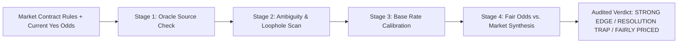

# 🛡️ OracleGuard

> **AI-Powered Prediction Market Resolution & Quantitative Edge Auditor**  
> *Built for Yeti Vibe Coding & the SERV Hackathon — Powered by OpenServ Reasoning API (`gpt-5.4-mini`)*

<p align="center">
  
</p>

<p align="center">
  
  
  
  
  
</p>

---

## 📌 Executive Summary

Prediction markets (Polymarket, Kalshi, PredictIt, UMA-based AMMs) represent a multi-billion dollar frontier for crowdsourced forecasting. However, **the fatal flaw of prediction markets lies in contract resolution ambiguity**:
1. **Resolution Traps:** Subjective linguistic criteria (e.g., "ceasefire" vs "formal peace treaty", "unnamed credible reports") lead to sudden, contentious oracle disputes and unfair payouts.
2. **Oracle Loopholes:** Unclear settlement deadlines, ambiguous timezone anchors, and dispute escalation delays create asymmetric risks where traders lose funds despite accurately predicting real-world events.
3. **Mispriced Odds:** Retail liquidity often miscalculates real catalyst base rates, leaving massive statistical edges for traders who can quantitatively model true fair probability.

**OracleGuard** solves this by deploying a bounded, 4-step autonomous reasoning agent powered by **OpenServ's SERV Reasoning API**. OracleGuard audits the verbatim contract settlement clauses, detects loophole risks, estimates fair statistical probability, and alerts traders before capital is committed.

---

## ⚡ The 4-Step Bounded Reasoning Pipeline

OracleGuard enforces bounded chain-of-thought verification across four stages:



1. **Stage 1: Resolution Criteria & Oracle Source Check**  
   Audits whether the oracle feed is cryptographic, deterministic, and backed by verifiable primary sources, identifying single points of failure.
2. **Stage 2: Ambiguity & Edge-Case Loophole Scan**  
   Scans contract verbiage for linguistic vagueness, conflicting news interpretations, and discretionary resolver overrides.
3. **Stage 3: Base Rate & Catalyst Calibration**  
   Synthesizes historical frequency baselines and upcoming macroeconomic or geopolitical catalysts to calculate the objective probability.
4. **Stage 4: Fair Odds vs. Market Odds Synthesis**  
   Calculates the mathematical edge:
   $$\text{Edge (\%)} = \text{Fair Calculated Probability (\%)} - \text{Market Yes Odds (\%)}$$
   Classifies the contract into **STRONG EDGE**, **FAIRLY PRICED**, or **RESOLUTION TRAP**.

---

## 🚀 Key Features

- **Autonomous 4-Step Reasoning Engine:** Built with strict schema validation against OpenServ's OpenAI-compatible reasoning endpoint (`https://inference-api.openserv.ai/v1`).
- **Resolution Trap Detection:** Flags high-risk wording that triggers oracle disputes before you enter a position.
- **Quantitative Edge Scoring:** Computes net statistical edge with clear directionality ($+$/$-$).
- **One-Click Presets:** Includes real-world test cases inspired by famous prediction market controversies.
- **Stateless & Portable:** Zero database, zero bloat, instant deployment on Vercel or any container platform.

---

## 🛠️ Tech Stack

- **Framework:** Next.js 14.2 (App Router, Server-side API Routes)
- **Language:** TypeScript 5.7
- **Styling:** Tailwind CSS 3.4 (Cyber-Dark Fintech theme)
- **AI Agent Inference:** OpenServ SERV Reasoning API (`gpt-5.4-mini`)
- **Icons & Assets:** Lucide React & Custom 1:1 Vector Identity

---

## 💻 Getting Started

### 1. Clone the Repository
```bash
git clone https://github.com/Alafedoyinsola/oracleguard-serv.git
cd oracleguard-serv
```

### 2. Install Dependencies
```bash
npm install
```

### 3. Configure Environment Variables
Create `.env.local` in the project root:
```env
SERV_API_KEY=your_openserv_api_key_here
SERV_MODEL=gpt-5.4-mini
```
*(Note: If `SERV_API_KEY` is omitted or set to default, OracleGuard automatically runs in high-fidelity simulated test mode, allowing offline demonstration.)*

### 4. Run Development Server
```bash
npm run dev
```
Open [http://localhost:3000](http://localhost:3000) in your browser.

### 5. Production Build
```bash
npm run build
npm start
```

---

## 📡 API Specification

### Endpoint: `POST /api/audit`

#### Request Payload
```json
{
  "question": "Will Protocol Alpha deploy zk-rollup mainnet before Q3?",
  "rules": "This market resolves to Yes if credible reports or announcements confirm mainnet activation. Resolves to No otherwise. Resolver discretion applies.",
  "marketYesOdds": 42,
  "contextNotes": "Subjective terminology introduces dispute risk."
}
```

#### Response Payload
```json
{
  "reasoning_steps": [
    {
      "step_number": 1,
      "stage_name": "Resolution Criteria & Oracle Source Check",
      "analysis": "Oracle source is vaguely defined without authoritative primary domain or cryptographic feed verification.",
      "status": "FAIL"
    },
    {
      "step_number": 2,
      "stage_name": "Ambiguity & Edge-Case Loophole Scan",
      "analysis": "High vulnerability to subjective interpretation and secondary disputes under resolver discretion clause.",
      "status": "FAIL"
    },
    {
      "step_number": 3,
      "stage_name": "Base Rate & Catalyst Calibration",
      "analysis": "Historical frequency indicates low probability of formal mainnet sign-off within specified window.",
      "status": "PASS"
    },
    {
      "step_number": 4,
      "stage_name": "Fair Odds vs. Market Odds Synthesis",
      "analysis": "Market Yes odds reflect significant narrative optimism compared to calibrated fair probability.",
      "status": "WARN"
    }
  ],
  "ambiguity_risk_score": 78,
  "loopholes": [
    "Oracle source lacks deterministic primary key or timestamp anchor.",
    "Ambiguous phrasing allows contradictory third-party interpretation."
  ],
  "fair_yes_probability": 18,
  "edge_percentage": -24.0,
  "verdict": "RESOLUTION TRAP",
  "summary": "OracleGuard flagged critical resolution loopholes that make this market high-risk for capital allocation. Traders face asymmetric dispute risk regardless of the underlying real-world event."
}
```

---

## 📄 License
This project is licensed under the [MIT License](LICENSE).
